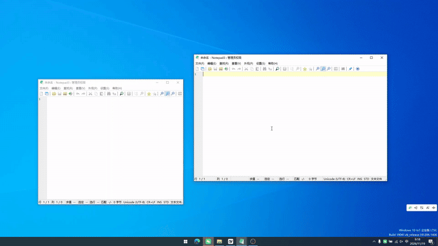

# Slick Window Arrangement（独立版）

把 Windhawk 的 [Slick Window Arrangement](https://windhawk.net/mods/slick-window-arrangement) 插件从 Windhawk 里拆出来，做成一个双击就能用的小工具。

Windhawk 本身很好，但只为了一个窗口吸附功能去装一整套 Mod 平台，对我来说有点重。于是补了 Windhawk 运行时里这个插件实际用到的部分，做成单文件 exe，顺手加了托盘、中文菜单和开机自启。



> 点击上面的动图可以看完整演示视频：[assets/demo.mp4](assets/demo.mp4)

## 它做什么

- 拖动窗口时，窗口边缘靠近其它窗口或屏幕工作区边缘会自动吸附。
- 松开鼠标后，窗口会带一点惯性继续滑，然后慢慢停下来。
- 托盘菜单可以单独开关：总开关、拖动吸附、滑动吸附、滑动动画。
- 托盘菜单是中文的，支持开机自启。
- 单文件，x64，不需要安装 Windhawk。

## 下载

去 [Releases](../../releases/latest) 下载：

- `SlickWindowArrangement-1.0.2-x64.zip`

解压后双击 `SlickWindowArrangement.exe` 就行。

第一次运行会在 exe 旁边释放一个 `SlickWindowArrangement-*.dll`，这是运行库，不是病毒。程序运行期间不要单独删它。

## 怎么用

双击后没有主窗口，只在托盘里。右键托盘图标：

- **启用**：总开关
- **拖动时吸附窗口**
- **滑动时吸附窗口**
- **滑动动画**
- **开机自启**
- **托盘图标设置...**
- **打开设置文件...**
- **重新加载设置**
- **退出**

如果 Windows 10 把新图标收进了任务栏的 `^` 隐藏区，点开 `^` 把图标拖到任务栏上，之后它就会一直显示。也可以点“托盘图标设置...”去系统设置里调整。

## 配置

第一次运行会在 exe 同目录生成 `config.ini`。如果目录不可写，会放到：

```text
%LOCALAPPDATA%\SlickWindowArrangement\config.ini
```

改完后右键托盘图标，点“重新加载设置”。

| 配置项 | 说明 |
| --- | --- |
| `Enabled` | 总开关，1/0 |
| `SnapWindowsWhenDragging` | 拖动时吸附，1/0 |
| `SnapWindowsDistance` | 吸附距离，默认 25，会按 DPI 缩放 |
| `KeysToDisableSnapping.Ctrl` | 按住 Ctrl 临时禁用吸附，1/0 |
| `KeysToDisableSnapping.Alt` | 按住 Alt 临时禁用吸附，1/0 |
| `KeysToDisableSnapping.Shift` | 按住 Shift 临时禁用吸附，1/0 |
| `SlidingAnimation` | 滑动动画，1/0 |
| `SnapWindowsWhenSliding` | 滑动时吸附，1/0 |
| `SlidingAnimationSlowdown` | 滑动减速，1-99；越小滑得越远、越久 |

## 为什么做这个

一开始只是觉得 Windows 的窗口排列太“硬”了：拖到边上“啪”一下吸住，松手就停，没什么手感。m417z 的这个插件刚好做了我想要的效果。

但 Windhawk 是一个完整的 Mod 平台，装它、配它、每次改设置还要开 Windhawk，对“只想让窗口滑一下”这件事来说太重了。所以这个仓库做的事情其实很朴素：把插件的逻辑留下来，把 Windhawk 的运行时换成能独立跑的版本，再加一个托盘壳。

不是重写，也不是什么新创意，就是把一个现成的好东西搬到更方便的位置。

## 关于维护

这个项目是给自己用的，基本功能都在，日常用没问题。

但我没有继续维护的打算，后面大概率不会再更新。遇到 bug 也不一定修，新的 Windows 版本或上游改动也可能让某些地方失效。

如果你需要改，直接 fork 就好，源码和构建脚本都在仓库里，不需要问我。

## 已知限制

- 只支持 64 位 Windows 10 / 11，只处理 64 位程序。
- 以管理员身份运行的程序，需要以管理员身份启动本工具才能注入。
- 带反作弊保护的游戏/程序默认跳过，避免触发保护。
- 程序没有代码签名，SmartScreen 或安全软件可能会提示；介意的话可以自己看源码构建。
- 安全软件可能会拦截“开机自启”。程序会依次尝试注册表、启动文件夹快捷方式、启动文件夹脚本和计划任务；如果全被拦截，会在弹窗里显示错误码。
- 托盘图标是否直接显示由 Windows 决定，Windows 10 默认会把新图标放进 `^` 隐藏区。

## 源码来源与许可

- 原始插件：[ramensoftware/windhawk-mods](https://github.com/ramensoftware/windhawk-mods) 中的 `slick-window-arrangement`，作者 [m417z](https://github.com/m417z)。
- `src/slick-window-arrangement.wh.cpp` 来自上游，为了脱离 Windhawk 编译做了少量适配。
- `src/windhawk_runtime.cpp`、`src/injector.cpp`、`src/mod.cpp` 是为了独立运行补的运行时、注入器和托盘程序。
- 本项目不是官方项目，和 m417z、Windhawk 没有隶属关系。如果上游作者认为有不合适的地方，可以通过 issue 联系处理。
- 本项目按 GNU General Public License v3.0 发布，完整文本见 [LICENSE](LICENSE)。

## 构建

需要：

- Windows x64
- [llvm-mingw](https://github.com/mstorsjo/llvm-mingw)（UCRT x86_64 版本）
- PowerShell
- Python 3（只用来把 DLL 嵌入 exe）

把 llvm-mingw 解压到仓库上一级的 `toolchain/` 目录，例如：

```text
parent/
  toolchain/
    llvm-mingw-20261104-ucrt-x86_64/
  this-repo/
```

然后在仓库根目录运行：

```powershell
powershell -ExecutionPolicy Bypass -File .\build.ps1
```

产物在 `dist/`。

## 致谢

- [m417z](https://github.com/m417z)：原始插件和思路
- [Windhawk](https://windhawk.net/)：Mod 平台
- [MinHook](https://github.com/TsudaKageyu/minhook)：函数 Hook
- [llvm-mingw](https://github.com/mstorsjo/llvm-mingw)：编译工具链
- 图标素材由项目发起人提供，仅用于本项目
